# QuickFund-X — Privacy-Preserving Cross-Institution Loan Fraud Intelligence via Heterogeneous Graph Neural Networks & Hybrid Rule Engine

[](.github/workflows/ci.yml)
[](central-fraud-intelligence/tests/)
[](central-fraud-intelligence/tests/)
[](package.json)
[](render.yaml)
[](package.json)

<p align="center">
  
</p>

> **Live Demo & Defense Highlights**:
> - **Interactive Cytoscape.js Force-Directed Graph (`/dashboard/graph`)**: Real-time node expansion color-coded **Blue** (legitimate applicants), **Yellow** (shared HMAC token hubs), and **Red** (flagged cross-platform fraud rings). Clicking any edge highlights the **GNN relation attention weight ($\alpha_{e}$)** and triggered rule signal.
> - **Single-Click Syndicate Attack Simulator (`⚡ Simulate Syndicate Attack` / `npm run demo:attack`)**: Fires 16 synthetic loan applications across **QuickFund**, **TrustLend**, **SecureCredit**, and **FinBridge** over 30 seconds with overlapping phone/email/document tokens, triggering real-time fraud incidents and cross-platform webhook notifications.
> - **Audit & Explainability Inspector ("Why was this flagged?")**: Visually decomposes every hybrid risk decision into **60% GNN Embedding Distance & Layer Attention Contribution** and **40% Rule Trigger Breakdown** (velocity burst multiplier + multi-tenant token match).
> - **Event-Driven Redis Streams + Outbox Broker**: Decoupled asynchronous event pipeline (`XADD` / `XREAD` on `quickfund:application_events` + Pub/Sub `quickfund:events:channel`) with automatic transactional outbox fallback.
> - **Live ML Hyperparameter Debugger (`/dashboard/model-debugger` & Streamlit)**: Dynamically slide the hybrid ratio (`0.6 GNN : 0.4 Rules` $\leftrightarrow$ `0.8 : 0.2`) and classification threshold (`0.50` $\leftrightarrow$ `0.70`) and watch True Positive / False Positive rates update live.

---

## 1. System Architecture

**QuickFund-X** connects four independent, isolated lending platforms — **QuickFund** (`loan-platform-a`, personal loans), **TrustLend** (`loan-platform-b`, education loans), **SecureCredit** (`loan-platform-c`, micro/collateralized loans), and **FinBridge** (`loan-platform-d`, consumer/digital bridge loans) — to a single **Central Fraud Intelligence** engine without ever sharing raw Personally Identifiable Information (PII).

### Mermaid Architecture Diagram

```mermaid
flowchart TB
    subgraph Platforms["Independent Lending Platforms (Isolated MongoDB + Local HMAC Tokenization)"]
        P_A["QuickFund (Platform A)\nExpress + MongoDB + Outbox"]
        P_B["TrustLend (Platform B)\nExpress + MongoDB + Outbox"]
        P_C["SecureCredit (Platform C)\nExpress + MongoDB + Outbox"]
        P_D["FinBridge (Platform D)\nExpress + MongoDB + Outbox"]
    end

    subgraph Broker["Asynchronous Event-Driven Broker Layer"]
        REDIS["Redis Streams (XADD / XREAD)\nStream: quickfund:application_events\nPub/Sub: quickfund:events:channel"]
        REST_FALLBACK["Transactional Outbox REST Fallback\nPOST /api/v1/applications/process"]
    end

    subgraph Central["Central Fraud Intelligence (FastAPI + PyTorch HeteroGraphSAGE + PostgreSQL)"]
        INGEST["Idempotent Event Consumer\n& Outbox Deduplicator"]
        GRAPH["Persistent Heterogeneous GraphStore\n(PostgreSQL + NetworkX MultiDiGraph)"]
        GNN["4-Layer HeteroGraphSAGE GNN\n(60% Weight Contribution)"]
        RULES["Velocity & Multi-Tenant Rule Engine\n(40% Weight Contribution)"]
        HYBRID["Hybrid Risk Scorer & Explainability Engine\nS_final = w_gnn * S_gnn + w_rule * S_rule"]
        INCIDENT["Incident & Cross-Platform\nWebhook Notification Worker"]
    end

    subgraph Portal["Interactive Visual & ML Defense Suite"]
        CYTO["Cytoscape.js Live Force-Directed Graph\n+ 'Why Was This Flagged?' Drawer\n+ Syndicate Attack Simulator"]
        STREAMLIT["Streamlit & Portal Model Debugger\nLive GNN:Rule Ratio & Threshold Sliders"]
    end

    P_A & P_B & P_C & P_D -->|"HMAC-SHA256 Tokenized Event"| REDIS
    P_A & P_B & P_C & P_D -.->|"Auto-Fallback"| REST_FALLBACK
    REDIS & REST_FALLBACK --> INGEST
    INGEST --> GRAPH
    GRAPH -->|"4-Hop Induced Subgraph"| GNN & RULES
    GNN & RULES --> HYBRID
    HYBRID -->|"FRAUD_DETECTED (>= 0.50)"| INCIDENT
    INCIDENT ==>|"Signed HMAC Webhook Alert"| P_A & P_B & P_C & P_D
    HYBRID & GRAPH --> CYTO & STREAMLIT
```



### ASCII Data-Flow & Privacy Boundary Diagram

```text
+---------------------------------------------------------------------------------------------------+
|                           FOUR INDEPENDENT TENANT LENDING PLATFORMS                               |
|  [QuickFund :4001]       [TrustLend :4002]       [SecureCredit :4003]       [FinBridge :4004]     |
|   MongoDB (db_a)          MongoDB (db_b)          MongoDB (db_c)             MongoDB (db_d)       |
|         |                       |                       |                          |              |
|         +-----------------------+-----------+-----------+--------------------------+              |
|                                             |                                                     |
|     PRIVACY BOUNDARY: Canonicalization + HMAC-SHA256(K_consortium, field) + Document SHA-256      |
|     (Zero raw names, emails, phones, or addresses ever leave the tenant platform boundary)        |
+---------------------------------------------|-----------------------------------------------------+
                                              v
+---------------------------------------------------------------------------------------------------+
|                     EVENT-DRIVEN MESSAGE BROKER (Redis Streams + Outbox)                          |
|   XADD quickfund:application_events * payload <JSON>  ===>  EventBrokerWorker (Async Consumer)    |
+---------------------------------------------|-----------------------------------------------------+
                                              v
+---------------------------------------------------------------------------------------------------+
|                         CENTRAL FRAUD INTELLIGENCE ENGINE (:8000 / :5000)                         |
|                                                                                                   |
|   [1] GraphStore Upsert (PostgreSQL `graph_nodes` & `graph_edges` + In-Memory MultiDiGraph)       |
|   [2] 4-Hop Induced Subgraph Extraction (`get_relevant_subgraph`)                                 |
|   [3] Parallel Scoring:                                                                           |
|        +-- (60%) 4-Layer HeteroGraphSAGE GNN (`GNNScorer`) -> Embedding Distance & Attention      |
|        +-- (40%) Deterministic Rule Engine (`evaluate_rules`) -> Velocity + Hub + 2-Party Cap     |
|   [4] Explainability Inspector (`generate_explanation`) + Incident & Webhook Dispatcher           |
+---------------------------------------------------------------------------------------------------+
```

---

## 2. Mathematical Formulation

### 2.1 Privacy-Preserving Consortium Tokenization (HMAC-SHA256)

To allow cross-platform entity resolution without exposing raw customer PII to the central intelligence service or competing lenders, each platform canonicalizes applicant attributes locally using a shared consortium secret key $K_{\text{consortium}} \in \{0,1\}^{256}$ before writing to its transactional outbox:

$$\tau_{\text{field}}(x) = \text{HMAC-SHA256}\!\left(K_{\text{consortium}},\, \mathcal{C}_{\text{field}}(x)\right)$$

where the field-specific canonicalization operators $\mathcal{C}_{\text{field}}$ enforce deterministic normalization across all four platforms:
- **Phone Canonicalization** $\mathcal{C}_{\text{phone}}(x)$: strips formatting characters and country prefixes (`+91`, leading `0`) to yield a canonical digit string.
- **Email Canonicalization** $\mathcal{C}_{\text{email}}(x)$: lowercases and trims whitespace (`alice@Example.COM` $\mapsto$ `alice@example.com`).
- **Name & Address Canonicalization** $\mathcal{C}_{\text{name}}(x), \mathcal{C}_{\text{addr}}(x)$: Unicode NFKC normalization, punctuation removal, whitespace collapsing, and lowercasing.
- **Document Content Fingerprint**: uploaded loan documents $D$ are hashed via $\tau_{\text{doc}}(D) = \text{SHA256}(\text{bytes}(D))$.

Because $\text{HMAC-SHA256}$ is a keyed pseudorandom function (PRF), the central graph observes deterministic pseudonymous vertices $v \in V_{\text{token}}$ that preserve graph isomorphism across platforms while remaining computationally irreversible under standard cryptographic assumptions.

---

### 2.2 Heterogeneous Graph Neural Network (4-Layer HeteroGraphSAGE)

Let $\mathcal{G} = (\mathcal{V}, \mathcal{E}, \mathcal{T}_v, \mathcal{T}_e)$ denote the central heterogeneous multi-relational graph with:
- **7 Node Types** $\mathcal{T}_v = \{\text{platform}, \text{application}, \text{borrower}, \text{phone\_token}, \text{email\_token}, \text{name\_token}, \text{address\_token}, \text{document\_hash}\}$
- **14 Directed Edge Relations** $\mathcal{T}_e$ (7 forward relations such as $\text{BORROWER\_HAS\_PHONE}$ plus 7 inverse relations $\text{rev\_*}$ so message passing flows bidirectionally across token bridges).

Why **4 Layers**? In our heterogeneous schema, two applications $a_1, a_2$ belonging to different platform accounts $b_1, b_2$ that share a phone token $t_{\text{phone}}$ are separated by **4 directed hops**:

$$a_1 \xleftarrow{\text{SUBMITTED}} b_1 \xrightarrow{\text{HAS\_PHONE}} t_{\text{phone}} \xrightarrow{\text{rev\_HAS\_PHONE}} b_2 \xrightarrow{\text{SUBMITTED}} a_2$$

At each layer $\ell \in \{1, 2, 3, 4\}$, for every node $v$ of type $\tau = \phi(v)$, the model aggregates neighbor representations across all incoming relation types $r = (\sigma, e, \tau) \in \mathcal{T}_e$:

$$\mathbf{h}_v^{(\ell)} = \text{ReLU}\!\left( \mathbf{W}_{\text{self},\tau}^{(\ell)} \mathbf{h}_v^{(\ell-1)} + \sum_{r=(\sigma,e,\tau) \in \mathcal{T}_e} \frac{1}{|\mathcal{N}_r(v)|} \sum_{u \in \mathcal{N}_r(v)} \mathbf{W}_{r}^{(\ell)} \mathbf{h}_u^{(\ell-1)} \right)$$

For the root application node $a_{\text{root}}$, the final fraud probability is computed via a linear readout head:

$$S_{\text{GNN}}(a_{\text{root}}) = \sigma\!\left(\mathbf{w}_{\text{out}}^{\top} \mathbf{h}_{a_{\text{root}}}^{(4)} + b_{\text{out}}\right) \in [0, 1]$$

---

### 2.3 Deterministic Rule Engine & Hybrid Scoring Decomposition

For each shared-token signal $s \in \{\text{phone}, \text{email}, \text{name}, \text{address}\}$ with base weight $\beta_s \in \{0.30, 0.30, 0.20, 0.12\}$, let $\Delta t_s$ (in hours) be the minimum submission time gap to a distinct borrower sharing that token, and $m_s = |\mathcal{B}_{\text{other}}(s)|$ be the count of distinct other borrower identities linked to that token. The time-proximity velocity multiplier $\lambda(\Delta t)$ and hub bonus $H(m_s)$ are:

$$\lambda(\Delta t) = \begin{cases} 1.0 & \text{if } \Delta t \le 24\text{h} \\ 1.0 - 0.95 \left(\frac{\Delta t - 24}{720 - 24}\right) & \text{if } 24\text{h} < \Delta t < 720\text{h} \\ 0.05 & \text{if } \Delta t \ge 720\text{h} \end{cases}, \qquad H(m_s) = \min\!\big(0.25,\, 0.08 \cdot \max(0, m_s - 2)\big)$$

To prevent false positives on a genuine borrower rate-shopping across two platforms (where all shared tokens trace back to only **1** other borrower account, $|\bigcup_s \mathcal{B}_{\text{other}}(s)| = 1$), the **Two-Party Correlated-Evidence Cap** bounds the combined token score at $C_{2\text{p}} = 0.35$:

$$S_{\text{Rule}}(a_{\text{root}}) = \min\!\left(1.0,\; \Phi_{2\text{p}}\!\left(\sum_{s} \big(\beta_s \lambda(\Delta t_s) + H(m_s)\big)\right) + \beta_{\text{doc}}\,\lambda(\Delta t_{\text{doc}})\,\mathbb{I}_{\text{doc}}\right)$$

Finally, the **Hybrid Risk Score** combines the GNN structural score and the rule engine score with runtime-tunable weights $(w_{\text{GNN}}, w_{\text{Rule}})$, defaulting to $(0.60, 0.40)$ and classification threshold $\theta = 0.50$:

$$S_{\text{final}}(a_{\text{root}}) = w_{\text{GNN}} \cdot S_{\text{GNN}}(a_{\text{root}}) + w_{\text{Rule}} \cdot S_{\text{Rule}}(a_{\text{root}}), \qquad \text{Decision} = \begin{cases} \texttt{FRAUD\_DETECTED} & \text{if } S_{\text{final}} \ge \theta \\ \texttt{CLEARED} & \text{if } S_{\text{final}} < \theta \end{cases}$$

---

## 3. Quantitative Benchmarking & Ablation Study

### 3.1 Architectural Ablation Study (`npm run benchmark:ablation`)

We evaluate three configurations on our controlled multi-platform benchmark dataset (`scripts/run_ablation_study.py`) comprising **Multi-Platform Fraud Rings** (explicit cross-platform syndicates + 2-hop relay/mule rings across Platforms A, B, C, D) and **Benign Multi-Application Borrowers** (genuine borrowers applying for an Education Loan on Platform A and a Personal Loan on Platform B using their own phone, email, and KYC document):

| Architecture Configuration | Multi-Platform Ring Recall | Benign Multi-App FPR | Precision | F1 Score | Latency P50 / P95 / P99 (ms) |
| :--- | :---: | :---: | :---: | :---: | :---: |
| **1. Siloed Rule Engine Only** *(No cross-platform sharing)* | `0.0%` | `0.0%` | `0.0%` | `0.000` | `0.89 / 1.33 / 1.64 ms` |
| **2. Centralized Rule Engine Only** *(Cross-platform, no GNN)* | `50.0%` | `25.0%` | `70.6%` | `0.585` | `1.05 / 1.76 / 2.04 ms` |
| **3. QuickFund-X Hybrid (`0.6 GNN + 0.4 Rules`)** | **`100.0%`** | **`0.0%`** | **`100.0%`** | **`1.000`** | **`5.29 / 7.13 / 7.36 ms`** |

<p align="center">
  
</p>

**Key Empirical Takeaways**:
1. **Why Siloed Rules Fail (`0.0%` Cross-Platform Recall)**: When a fraud syndicate submits 1 application on QuickFund, 1 on TrustLend, 1 on SecureCredit, and 1 on FinBridge, each platform's local database sees a first-time applicant with zero local history.
2. **Why Centralized Rules Alone Over-Flag Benign Borrowers (`25.0%` FPR) & Miss Relay Rings (`50.0%` Recall)**: A genuine borrower applying for an Education Loan on Platform A and a Personal Loan on Platform B who uploads their genuine KYC/income document triggers `0.35 (two-party token cap) + 0.40 (shared document hash) = 0.75 >= 0.50` in a rules-only system. Conversely, 2-hop mule rings that rotate primary identifiers evade 1-hop deterministic rules.
3. **Why QuickFund-X Hybrid Excels (`100.0%` Recall, `0.0%` Benign FPR)**: For a genuine 2-platform borrower, the 4-layer HeteroGraphSAGE GNN recognizes the low-degree 2-application pair ($S_{\text{GNN}} \le 0.12$), damping the hybrid score to $0.6(0.12) + 0.4(0.75) = 0.372 < 0.50$ (`CLEARED`). For multi-hop fraud rings, 4-layer message passing surfaces high structural risk ($S_{\text{GNN}} \ge 0.88$), achieving full detection with sub-8ms P99 latency.

---

### 3.2 Concurrency & Throughput Scaling (`50`, `100`, and `500` Concurrent Applications)

Benchmarked via `scripts/run_load_benchmark.py` (`npm run benchmark:load`), `scripts/locustfile.py` (Locust), and `scripts/k6_load_test.js` (k6) against the full central ingestion pipeline (Event Deduplication + GraphStore Upsert + 4-Hop Subgraph Extraction + 4-Layer HeteroGraphSAGE Inference + Rule Engine + Incident Creation):

| Concurrency Tier | Total Requests | Sustained Throughput | P50 Latency | P95 Latency | P99 Latency | Error Rate |
| :---: | :---: | :---: | :---: | :---: | :---: | :---: |
| **50 Concurrent Apps** | `150` | `51.80 req/s` | `391.2 ms` | `754.2 ms` | `915.7 ms` | **`0.00%`** |
| **100 Concurrent Apps** | `200` | `52.14 req/s` | `358.1 ms` | `931.7 ms` | `1,106.4 ms` | **`0.00%`** |
| **500 Concurrent Apps** | `500` | `64.61 req/s` | `1,722.4 ms` | `3,530.2 ms` | `4,225.7 ms` | **`0.00%`** |

<p align="center">
  
</p>

---

## 4. Quick-Start & Live Viva Commands

### 4.1 One-Command Demo Reset & Syndicate Attack Simulator

During live demonstrations or external viva examinations, use these root CLI commands to wipe/reseed all databases or trigger a live cross-platform attack:

```bash
# 1. Bulletproof Reset: Wipes all 4 MongoDBs + Central Postgres + Redis Stream & seeds 4 clean baseline applications
npm run demo:reset

# 2. Syndicate Attack Simulator: Fires 16 synthetic cross-platform collusion applications over 30 seconds
npm run demo:attack

# 3. Fast Attack Mode (3-second burst for quick testing)
npm run demo:attack:fast

# 4. Launch Standalone Streamlit ML Model Debugger (Port 8501)
npm run demo:debugger
```

### 4.2 Running the Full Stack via Docker Compose

```bash
cp .env.example .env
docker compose up --build -d
docker compose ps
```

### 4.3 Running Automated Benchmarks & Test Suites

```bash
# Run Quantitative Ablation Study (generates JSON + SVG chart)
npm run benchmark:ablation

# Run 50 / 100 / 500 Concurrency Scaling Benchmark (generates JSON + SVG chart)
npm run benchmark:load

# Run Locust or k6 Load Tests against a live server
locust -f scripts/locustfile.py --headless -u 100 -r 20 -t 30s --host http://localhost:8000
k6 run scripts/k6_load_test.js

# Run all 282 Central Intelligence Pytest tests + all 4 Loan Platform Jest suites
npm test
```

---

## 5. Repository Layout

```text
quickfund-x/
├── .github/workflows/ci.yml        # GitHub Actions CI (4x Platform Jest + Central Pytest + Ablation)
├── central-fraud-intelligence/     # Central FastAPI + 4-Layer HeteroGraphSAGE GNN + Rule Engine
│   ├── debugger/streamlit_app.py   # Standalone Streamlit ML Hyperparameter & ROC Debugger
│   ├── models/gnn_model.pt         # Trained PyTorch HeteroGraphSAGE checkpoint
│   ├── src/
│   │   ├── api/                    # REST endpoints (/applications, /demo, /broker, /incidents)
│   │   ├── explainability/         # 60% GNN Attention + 40% Rule Trigger Inspector decomposition
│   │   ├── fraud_detection/        # Deterministic rule engine + runtime-tunable hybrid scorer
│   │   ├── gnn/                    # 4-Layer HeteroGraphSAGE architecture, features, inference
│   │   ├── graph/                  # Persistent GraphStore (PostgreSQL + NetworkX MultiDiGraph)
│   │   ├── ingestion/              # Idempotent repository + Redis Streams / Pub-Sub broker worker
│   │   └── web/                    # Admin Portal + Cytoscape.js Live Graph + Model Debugger UI
│   └── tests/                      # 282 comprehensive unit, integration, and Phase 33 tests
├── loan-platform-a/                # QuickFund (Consumer Loans — React + Express + MongoDB + Redis Outbox)
├── loan-platform-b/                # TrustLend (Education Loans — React + Express + MongoDB + Redis Outbox)
├── loan-platform-c/                # SecureCredit (Micro Loans — React + Express + MongoDB + Redis Outbox)
├── loan-platform-d/                # FinBridge (Digital Loans — React + Express + MongoDB + Redis Outbox)
├── docs/assets/                    # High-res animated demo SVG, ablation chart, throughput scaling chart
├── performance-results/            # Empirical JSON benchmark outputs (ablation + 50/100/500 load)
├── scripts/                        # demo_reset.py, demo_attack.py, run_ablation_study.py, locustfile.py, k6
├── docker-compose.yml              # 11-service stack (4 platforms, 4 MongoDBs, Redis broker, Postgres, Central)
└── render.yaml                     # Cloud-native staging blueprint for Render
```

---

## 6. Documentation Index

| Document | Contents |
| :--- | :--- |
| [`ARCHITECTURE.md`](ARCHITECTURE.md) | System design, heterogeneous graph schema, and technology choices |
| [`DATA_FLOW.md`](DATA_FLOW.md) | End-to-end path of an application from tenant submission through Redis Streams to webhook alert |
| [`SECURITY.md`](SECURITY.md) | HMAC-SHA256 tokenization, privacy boundaries, JWT & API key authentication |
| [`ML_MODEL.md`](ML_MODEL.md) | 4-Layer HeteroGraphSAGE architecture, training methodology, and evaluation findings |
| [`PERFORMANCE.md`](PERFORMANCE.md) | Quantitative ablation study & 50/100/500 concurrency load-testing results |
| [`DEPLOYMENT.md`](DEPLOYMENT.md) | Render cloud-native staging blueprint & 11-container Docker Compose guide |
| [`TESTING.md`](TESTING.md) | Test coverage breakdown across all 4 platforms and central intelligence |
| [`DEMO_SCENARIOS.md`](DEMO_SCENARIOS.md) | Detailed walkthrough of fraud ring scenarios and viva presentation steps |
| [`API.md`](API.md) | Full HTTP & Redis Streams API reference |
